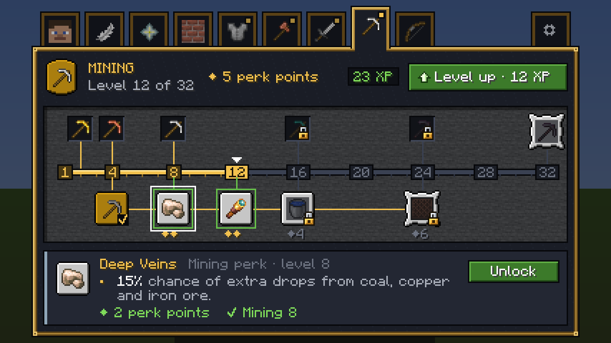

# Reskilled

Skills, perks and gear locks for [Minecraft Horizon](https://github.com/horizon-rust/horizon) (26.3).

**Grow a character, not just a pile of loot.**

- **Eight skills**: Melee, Ranged, Defense, Mining, Gathering, Agility, Arcane and Building, each from level 1
  to 32.
- **Level up your way**: spend XP, or, if the server allows it, just do the work (mining raises Mining,
  fighting raises Melee).
- **Gear that waits for you**: a diamond pickaxe needs Mining 16, netherite armor Defense 24, Sharpness V
  Arcane 12.
- **40 perks** to unlock with the points your levels earn, such as extra ore drops, more armor, or surviving a
  killing blow.
- **Fully tunable**: servers change the rules in game, and packs and mods can add, change or remove anything.

See [reskilled/README.md](reskilled/README.md) for every skill, perk and lock.

- **Players and server operators:** [reskilled/README.md](reskilled/README.md). The mod file is on the
  [releases page](../../releases).
- **Pack and mod makers:** [reskilled/claude-skill/reskilled-modding](reskilled/claude-skill/reskilled-modding/SKILL.md)
  (data reference and an example pack) and [reskilled/INTEGRATION.md](reskilled/INTEGRATION.md) (calls from code).
- **Working on the mod:** [reskilled/TESTING.md](reskilled/TESTING.md) and [reskilled/AGENTS.md](reskilled/AGENTS.md).

Not affiliated with Mojang, Microsoft or the Horizon project. MIT licensed: see [LICENSE](LICENSE).
