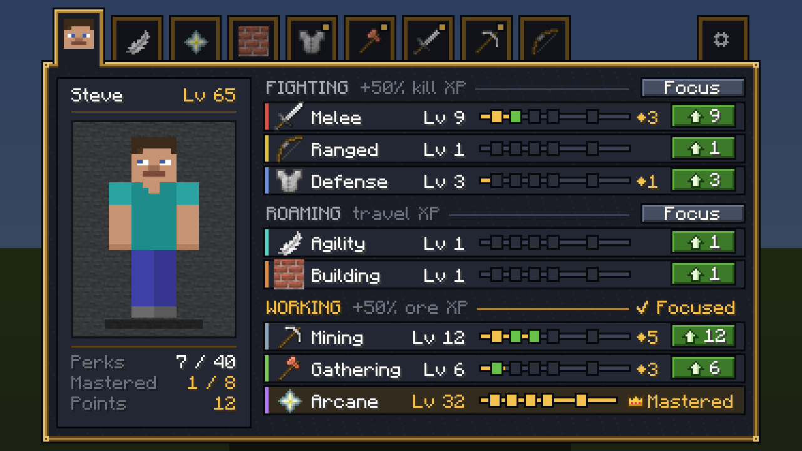

# Reskilled

Skills, perks and gear locks for [Minecraft Horizon](https://github.com/horizon-rust/horizon) (26.3). Players raise
eight skills with XP, unlock perks along each skill's road, and need levels to use gear. Everything is data, so
packs and other mods can change, add or remove any of it.

See [reskilled/README.md](reskilled/README.md) for every skill, perk and lock.

- **Players and server operators:** [reskilled/README.md](reskilled/README.md). The mod file is on the
  [releases page](../../releases).
- **Pack and mod makers:** [reskilled/claude-skill/reskilled-modding](reskilled/claude-skill/reskilled-modding/SKILL.md)
  (data reference and an example pack) and [reskilled/INTEGRATION.md](reskilled/INTEGRATION.md) (calls from code).
- **Working on the mod:** [reskilled/TESTING.md](reskilled/TESTING.md) and [reskilled/AGENTS.md](reskilled/AGENTS.md).

Not affiliated with Mojang, Microsoft or the Horizon project. MIT licensed: see [LICENSE](LICENSE).
