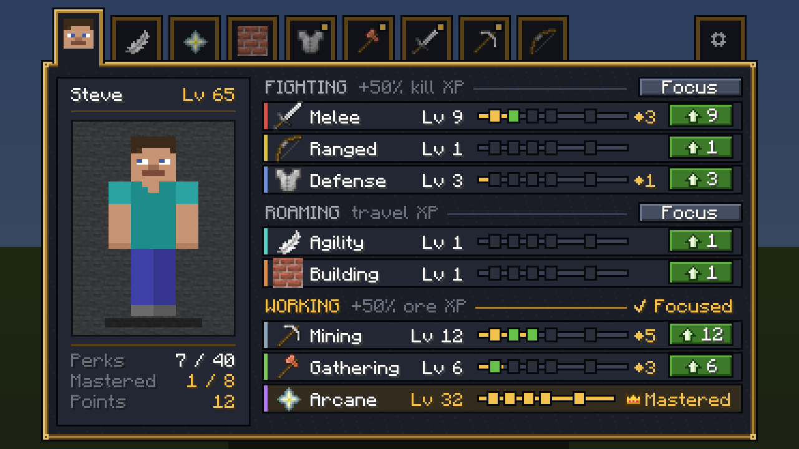
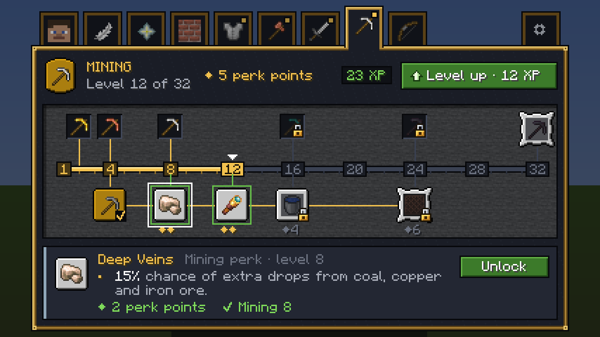
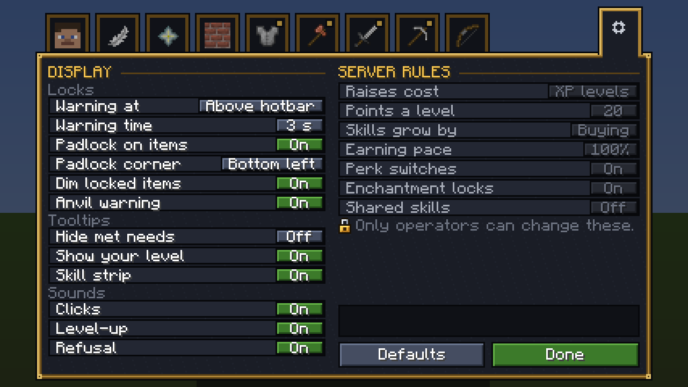

# Reskilled

Skills, perks and gear locks for Minecraft Horizon (26.3). Fills the role of Reskillable and Level Up! Reloaded on
Horizon (not affiliated).

Players raise eight skills with their XP (or by doing the work, if the server prefers), spend the perk points the
levels earn on perks, and need levels before gear will work for them: a diamond pickaxe asks for Mining 16, a shield
for Defense 12, Sharpness V for Arcane 12. Everything is data, so packs and other mods can retune, add or remove any
of it, and the server's rules change in game.

*The screen images are drawn by the mod's own screen code with the game's textures and font, by
`tools/preview.py`.*

## The skills window

Press **K** (or `/skills open`). The window has a tab for Home, one per skill, and one for Options; a gold dot on a
skill's tab means it has perk points to spend.

**Home** shows you (Steve, whose eyes follow the mouse), your total level, how many perks you own and skills you
have mastered, and your unspent points. Beside it are your skills, grouped by focus area: each row has the skill's
level, a small road of its perks (gold owned, green ready, dark not yet), its points, and its raise button. Click a
row to open that skill.

**A skill's tab is a road** from level 1 to the top (32). Above it, the gear each level opens (padlocked until you
get there; hover one to see what it is). Below it, the perks in advancement frames: gold when owned, outlined in green
when you can unlock one now, padlocked otherwise, with their price in perk points underneath and lines to the perks
they require. The panel at the bottom describes the perk under the mouse (or the one you clicked, or the next to
unlock): what it does, what it needs, ticked or crossed, and its **Unlock**, **On/Off** and **Area** buttons.

The header has the skill's level, your points, your XP and **Level up**. Shift-click raises 5 levels, Ctrl-click as
many as your XP pays for; hold either to see where it leads and the price.

**Options** holds your own display settings on the left (where the lock warning shows and for how long, the padlock
on locked items and its corner, dimming locked items, the anvil warning, tooltips, the skill strip beside your
inventory, sounds) and the server's rules on the right. Hover a row to have it explained.

## Skills and perks

Each skill has five perks, at levels 4, 8, 12, 16 and 24, costing 2, 2, 2, 4 and 6 perk points. You earn a perk
point every 2 levels. Some perks also need another perk first, or a level in another skill.

| Skill | Grows by doing | Perks |
|---|---|---|
| **Melee** | hitting creatures | Steady Hand (+10% attack speed), Heavy Swing (+1 attack damage), Wide Arc (sweeps hit nearby mobs, +0.5 reach), Bloodrush (Strength I after a kill), Battle Trance (+15% melee damage, +1 damage) |
| **Ranged** | landing shots | Keen Eye (+8% projectile damage), Long Shot (+10%), Soft Tread (+50% sneaking speed), Hunter's Cover (-20% projectile damage taken), Deadeye (+15%) |
| **Defense** | taking hits | Thick Skin (+1 armor), Blast Ward (-20% explosion damage), Tempered Plates (+1 toughness), Last Breath (survive a killing blow at half a heart, every 5 minutes), Unbroken (+2 max hearts, -10% melee damage taken) |
| **Mining** | breaking blocks with a pickaxe | Sure Grip (+5% break speed), Deep Veins (15% extra coal, copper and iron), Tunnel Reach (+0.5 reach), Flooded Shafts (double mining speed underwater), Stone Singer (+3 efficiency, +10% break speed) |
| **Gathering** | breaking blocks with an axe, shovel, hoe or shears | Bountiful Rows (20% extra crops), Timber Sense (15% extra logs), Green Aura (nearby crops grow faster), Replant (ripe crops replant themselves), Full Granary (+10% break speed, more extra crops) |
| **Agility** | travelling | Light Step (+5% speed), Pearl Step (no ender pearl damage), Spring Heels (+10% jump), Ledge Walker (step up full blocks), Wind Runner (+5% speed, -30% fall damage) |
| **Arcane** | enchanting | Spellward (-30% magic damage), Runeblade (+3% melee damage per enchantment), Warding Runes (-1% damage taken per armor enchantment), Antidote (harmful effects 40% shorter), Living Runes (enchanted gear repairs itself) |
| **Building** | placing blocks | Salvage (blocks you placed drop themselves), Restful Sleep (harmful effects lift in bed; sleep the night through to clear them and heal), Hearth (Regeneration near your bed), Home Ward (no block damage from explosions near your bed), Safe Haven (no monster spawns near your bed) |

A skill at the top with all five perks is **mastered**. Perks that act around your bed or around you (Hearth, Home
Ward, Safe Haven, Green Aura) have an **Area** button that draws the ground they cover in the world. When the server
allows it, any owned perk can be switched off and on again.

**Focus areas** give extra XP for their work. The first is free; each more costs 10 XP levels.

| Focus | Skills | Gives |
|---|---|---|
| Fighting | Melee, Ranged, Defense | 50% more XP from kills |
| Working | Mining, Gathering, Arcane | 50% more XP from ores, and XP for mining, digging, chopping, harvesting and smelting |
| Roaming | Agility, Building | XP for travelling, taming and breeding |

## Gear locks

Gear works only once you have the level for it. A locked item shows a padlock and, in its tooltip, what it needs;
using it anyway is refused with a short message saying why.

| What | Needs |
|---|---|
| Pickaxes | Mining: copper 4, iron 8, diamond 16, netherite 24 (gold: 2, and Arcane 4) |
| Axes, shovels, hoes (breaking, stripping, paths, tilling) | Gathering, same tiers |
| Swords, axes and spears in a fight | Melee, same tiers |
| Armor | Defense, same tiers (chainmail 4) |
| Horse and nautilus armor | Agility, same tiers |
| Bow, crossbow, trident, mace | Agility 2, Ranged 6, Ranged 16, Melee 20 |
| Shield, elytra | Defense 12, Agility 32 |
| Ender pearls, eyes of ender | Arcane 8, Arcane 16 |
| Riding horses and other mounts, a happy ghast | Agility 4, Agility 12 |
| Enchanting table, brewing stand | Arcane 12, Arcane 8 to open |
| Placing scaffolding; machines (pistons, hoppers...); workshops (anvils, observers...); wonders (beacons, conduits...) | Building 4, 8, 12, 16 |
| Enchanted gear | Arcane 3 a level from level II (Sharpness V: Arcane 12); Fortune and Looting 6 a level; Mending 12 |

Anvils open for anyone. Taking an anvil result you can't use yet asks first (click it again to take it); the warning
can be turned off. Gear you can no longer wear (after a reset, say) comes off by itself, and creative and spectator
players ignore locks.

## Commands

`/skills` lists your skills; `/skills raise <skill>`, `/skills perk <perk>`, `/skills focus <area>` and
`/skills party ...` do the rest from chat.

## For server operators

The **Server rules** column of the Options tab (operators only) sets:

- how raises are paid: XP levels or XP points (and how many points a level);
- how skills grow: by buying levels, by doing the work, or both (and how fast doing pays);
- whether owned perks can be switched off and on;
- whether enchantment locks apply;
- shared skills: off, within parties, or for everyone (a player's skills lift to the best level shared with them).

The rules are kept with the world.

Operator commands: `/skills set <player> <skill> <level>`, `/skills points <player> <skill> <n>`,
`/skills reset <player> [skill]`.

## For pack makers

Every skill, perk, focus area, lock and setting is a JSON file under `data/<namespace>/reskilled/<folder>/`
(`skills`, `perks`, `focus`, `locks`, `settings`). The files this mod ships have priority 0. To change one, ship a
file with the same id and `"priority": 1` or more in your pack's data; lock files add up, and an entry with
`"replace": true` drops earlier locks on the same target. `settings` files merge field by field, highest priority
last, except the lists `not_creatures`, `projectile_damage` and `equip_slots`, which add up. A file with the same id,
a higher priority and `"remove": true` removes a skill, perk or focus area. Each skill's `earned_by` says what work
grows it. `/reload` applies changes, and gear a player may no longer wear comes off. Every field is in the
[data reference](claude-skill/reskilled-modding/reference.md).

Other mods can add their own unlockables, including abilities with no item behind them: see
[integration.md](claude-skill/reskilled-modding/integration.md).

### Customizing with Claude

Reskilled ships a Claude Code skill that knows its data format, the override and removal rules, and the usual
mistakes. Copy the folder `claude-skill/reskilled-modding` into `~/.claude/skills/` (every project) or into your
pack's `.claude/skills/` (that pack only), then ask Claude for the change ("lock my mod's drill behind Mining 12",
"add a Fishing skill with three perks", "remove Keen Eye"). Other agents can read the same folder:
[SKILL.md](claude-skill/reskilled-modding/SKILL.md) and its
[field reference](claude-skill/reskilled-modding/reference.md). The skill's example pack is loaded by the mod's
tests, so it always matches the format the game reads.

## Building

The mod is two parts: `content/` (data and language files, a content mod) and `native/` (the rules, a native trait
mod pinned to one Horizon commit, see [HORIZON_PIN.md](HORIZON_PIN.md)).

- Tests: `cargo test --workspace` at the repository root.
- One file for players and the registry: `python3 -I reskilled/tools/package.py` writes `dist/reskilled.hmod`,
  then `cargo horizon-mod check dist/reskilled.hmod` validates it.
- Playing from source: `horizon-launcher native-build reskilled/native --instance <instance> --trust-native-code`,
  with the content mod built by `cargo horizon-mod build` in `content/`.
- Before a release: the in-game checklist in [TESTING.md](TESTING.md).
